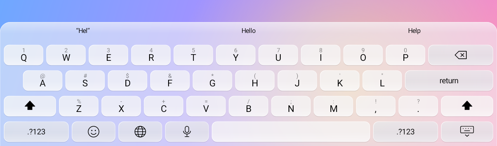
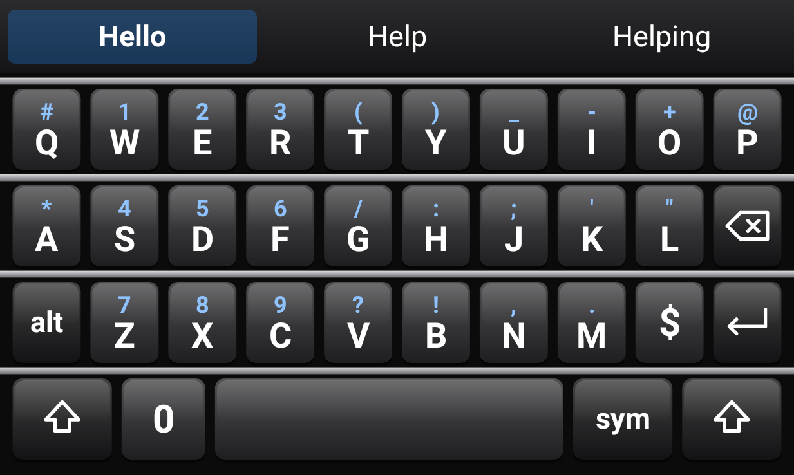

# MK Board: iPhone-style (Liquid Glass) and BlackBerry-style keyboards for Android

One APK, **two separate system keyboards**. Each appears on its own in Android's keyboard list and has its own settings, languages and colours.

| Keyboard | Look |
|---|---|
| **MK Board · iPhone** | **Liquid Glass** design: a frosted, see-through sheet with rounded top corners that blurs the app behind it (Android 12+), translucent glass keys with light-catching edges, glass key-pop balloons, 3-word suggestion bar, `123` / `#+=` / emoji pages, globe + mic strip, glass action key (Go/Search/Send/Done). The classic opaque iOS look is still available. |
| **MK Board · BlackBerry** | Sculpted glossy keycaps, chrome fret lines between rows, Bold/Q-series layout with alt symbols printed on each key, `alt` / `sym` / `aA` / `$` / `0` keys |

## Phones, tablets and foldables
- **Tablets and unfolded foldables:** the iPhone-style keyboard switches to an **iPad-style layout**, with delete, return and both shift keys, plus `.?123` keys on both sides and a hide-keyboard key. Each key shows a small number or symbol; **swipe down on a key** to type it.
- **Folding and unfolding** rebuilds the keyboard for the new screen straight away. Rotation and split-screen work too.
- **Landscape** uses shorter rows, and the keyboard never covers more than about half the screen.
- The BlackBerry-style keyboard stays **centred** on wide screens, like a real hardware keyboard. You can switch it to full width.
- The settings screens are centred at a readable width on big screens.

## Install
1. Copy `dist/MKBoard-2.0.apk` to the device and open it (allow "install unknown apps" when asked). Android 9 or newer.
2. Open **MK Board** → *Open keyboard settings* → turn on one or both keyboards.
3. *Switch keyboard…* → pick the one you want.

## Per-keyboard settings
- **Design (iPhone):** Liquid Glass on/off, glass transparency (frosted ↔ clear).
- **Languages:** English, Arabic, Spanish, French (AZERTY), German (QWERTZ), Italian, Portuguese, Russian, Turkish.
- **Colours:** 10–12 themes each (including Liquid Light / Liquid Dark), plus a custom colour for every part of the keyboard (swatches, sliders or hex).
- **Size, typing and feedback:** height, auto-capitals, caps lock, "." shortcut, suggestions, key preview, sound, vibration.
- **Tablets & foldables:** iPad layout on/off (iPhone); centred or full width (BlackBerry).

## Privacy
No internet permission. Learned words stay on the device and can be cleared from settings.

## Build
```
./gradlew assembleRelease          # APK → app/build/outputs/apk/release/
./gradlew testDebugUnitTest        # renders keyboards and screens (phone, tablet, foldable, landscape) to shots/*.png
```
The look is drawn in code from scratch. It does not use Apple or BlackBerry fonts, icons or artwork.




