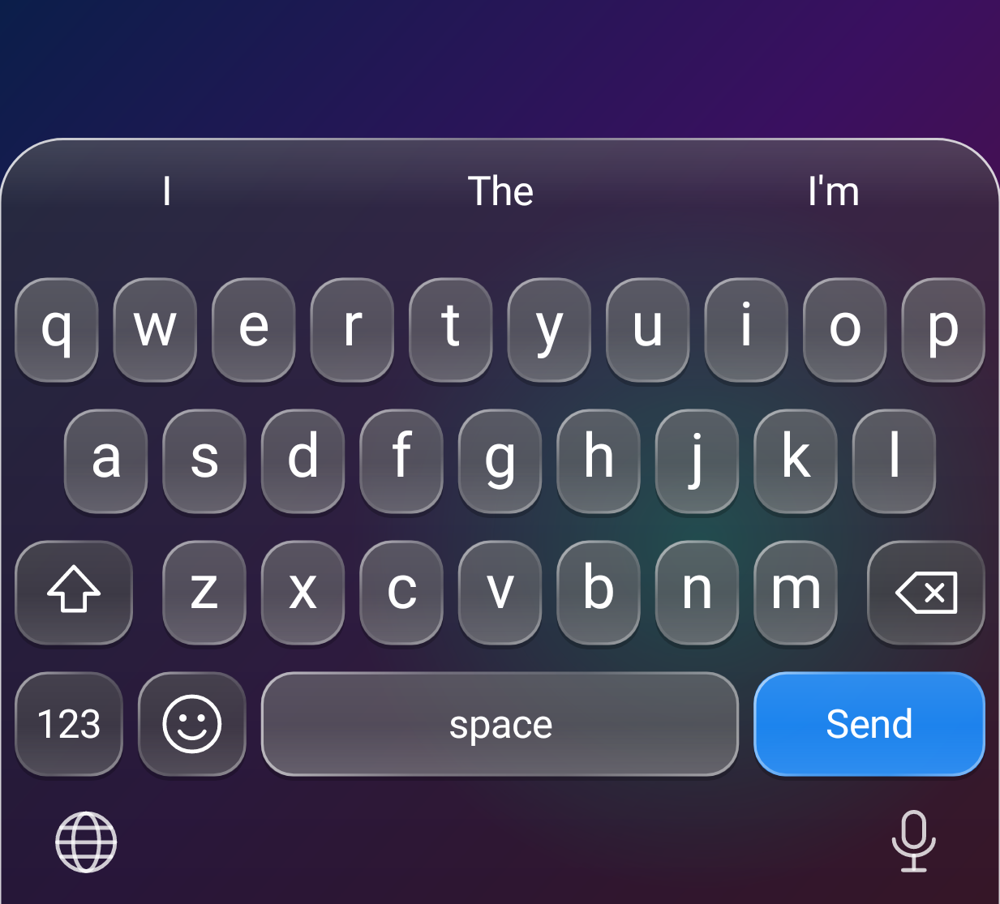

# MK Board

**iPhone-style (Liquid Glass) and BlackBerry-style keyboards for Android: phones, tablets and foldables.**

One app, two separate system keyboards, each with its own settings, languages and colours.

<p>


</p>


## Download
Get the latest APK from **[MK-Board-releases](https://github.com/Mkuz1/MK-Board-releases/releases/latest)** (Android 9 or newer). This source repo is private; APKs and release notes are published to that public repo.

1. Open the APK on your phone (allow "install unknown apps" when asked).
2. Open **MK Board** → *Open keyboard settings* → turn on one or both keyboards.
3. *Switch keyboard…* → pick **MK Board · iPhone** or **MK Board · BlackBerry**.

### Automatic updates
MK Board checks the public [MK-Board-releases](https://github.com/Mkuz1/MK-Board-releases) repo a few times a day. When a new version is out it shows a notification. Tap it, then **Update now**, and Android installs the update after one confirmation. You can also check by hand on the app's main screen, under *Updates*.

> Upgrading from 2.0 or older? Those builds used a temporary signing key. Uninstall once and install 2.1.0. Every update after that installs in place.

## Features

| | **MK Board · iPhone** | **MK Board · BlackBerry** |
|---|---|---|
| Look | Liquid Glass: frosted see-through sheet that blurs the app behind it (Android 12+), glass keys with light-catching edges. The classic iOS look can be switched back on. | Sculpted glossy keycaps, chrome fret lines, alt symbols printed on keys |
| Layout | iPhone layout on phones; **iPad layout** on tablets and unfolded foldables (swipe down on a key for its number or symbol) | Bold / Q-series layout with `alt`, `sym`, `aA`, `$`, `0`; centred on wide screens |
| Extras | 3-word predictions, key-pop balloons, emoji pages, globe and dictation keys, blue action key | Alt-lock, symbol and emoji pages, suggestion bar |

**Both keyboards include:**
- **Languages:** English, Arabic, Spanish, French (AZERTY), German (QWERTZ), Italian, Portuguese, Russian, Turkish.
- **Colours:** themes plus a custom colour for every part of the keyboard.
- **Typing and feedback:** height control, auto-caps, caps lock, double-space full stop, accents on long-press, space-bar cursor, delete-word repeat, sound and haptics.
- **Screen changes:** the keyboard rebuilds itself when a foldable folds or unfolds, on rotation and in split-screen.

## Privacy
Nothing you type ever leaves the device. The app's only network use is checking GitHub Releases for updates, and you can turn that off. Learned words stay on the phone and can be cleared.

## Building
```bash
./gradlew assembleRelease        # APK → app/build/outputs/apk/release/
./gradlew testDebugUnitTest      # tests + renders keyboards/screens to shots/*.png
```
Release builds are signed with the MK Board key from `keystore.properties` or the `MKBOARD_*` environment variables. Neither is committed. Without them, the build falls back to a debug key, which is only useful for local testing.

## Publishing a new version
1. Bump `versionCode` and `versionName` in `app/build.gradle`. The app updates only when the version number goes up.
2. Optionally add `release-notes/<version>.md`.
3. Push a tag: `git tag v2.2.0 && git push origin v2.2.0`.

The **Release** workflow builds the signed APK and publishes it as a release on **Mkuz1/MK-Board-releases**. Every installed copy of MK Board will then offer the update.

Repository secrets:

| Secret | Purpose |
|---|---|
| `RELEASES_TOKEN` | Fine-grained personal access token with **Contents: read and write** on `Mkuz1/MK-Board-releases`. Needed to publish. |
| `MKBOARD_KEYSTORE_BASE64`, `MKBOARD_KEYSTORE_PASSWORD`, `MKBOARD_KEY_ALIAS`, `MKBOARD_KEY_PASSWORD` | Sign the APK in CI. If these aren't set, the prebuilt, already-signed `dist/MKBoard-<version>.apk` is used. |

---
The keyboards are drawn from scratch in code. MK Board does not use Apple or BlackBerry fonts, icons or artwork, and is not affiliated with either company.
