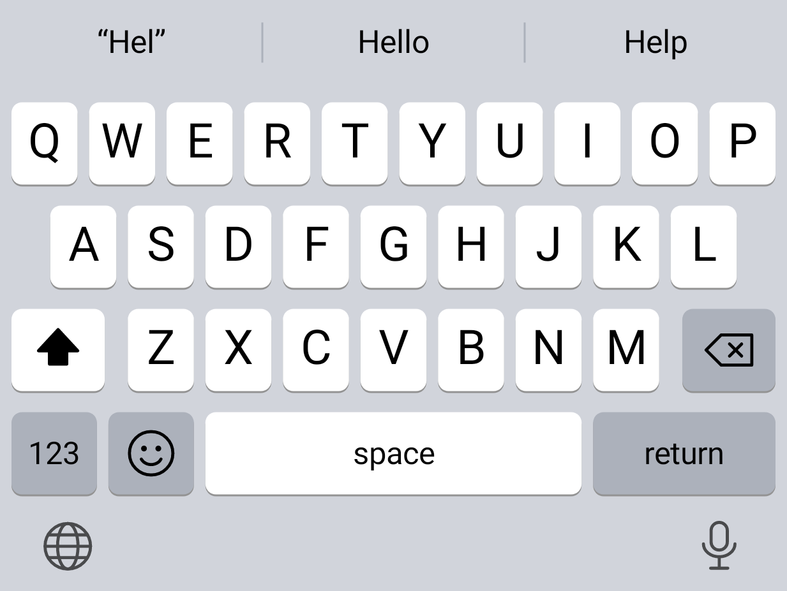

# Zen Keyboards — iPhone-style + BlackBerry-style keyboards for Android

One APK, **two separate system keyboards**. Each one appears on its own in Android's keyboard list and has its own settings, languages and colours.

| Keyboard | Look |
|---|---|
| **Zen Glass (iPhone style)** | Rounded white keys on a grey tray, key-pop balloons, QuickType-style 3-word bar, `123` / `#+=` / emoji pages, globe + mic strip, blue action key (Go/Search/Send/Done) |
| **Zen Classic (BlackBerry style)** | Sculpted glossy keycaps, chrome fret lines between rows, Bold/Q-series layout with alt symbols printed on each key, `alt` / `sym` / `aA` / `$` / `0` keys |

## Install
1. Copy `dist/ZenKeyboards-1.0.apk` to the phone and open it (allow "install unknown apps" when asked). Android 9 or newer.
2. Open **Zen Keyboards** → *Open keyboard settings* → turn on one or both keyboards.
3. *Switch keyboard…* → pick the one you want.

## Per-keyboard settings
- **Languages:** English, Arabic, Spanish, French (AZERTY), German (QWERTZ), Italian, Portuguese, Russian, Turkish. Turn on several and switch with 🌐 (hold it for the list).
- **Colours:** 10 built-in themes for each keyboard, plus a custom colour for each part (background, keys, function keys, text, accent; on BlackBerry also frets and alt symbols). Pick from swatches, hue/saturation/brightness sliders, or type a hex code.
- **Height:** 80–130 %.
- **Typing:** auto-capitalisation, caps lock (double-tap shift), double-space full stop, word suggestions, key pop-up preview, sound, vibration.

## Gestures
- Hold a letter for accents (and on BlackBerry, the alt symbol / capital letter).
- Drag along the space bar to move the cursor.
- Hold delete to erase repeatedly; after a moment it erases whole words.
- BlackBerry: tap `alt` once for one symbol, double-tap to lock it.

## Privacy
No internet permission. Learned words stay on the device and can be cleared from settings.

## Build
```
./gradlew assembleRelease          # APK → app/build/outputs/apk/release/
./gradlew testDebugUnitTest        # renders keyboards/screens to shots/*.png
```
The look is drawn in code from scratch. It does not use Apple or BlackBerry fonts, icons or artwork.



