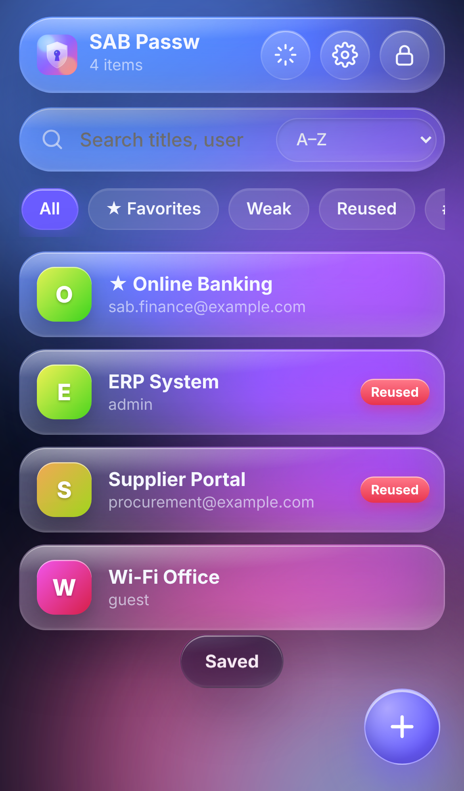
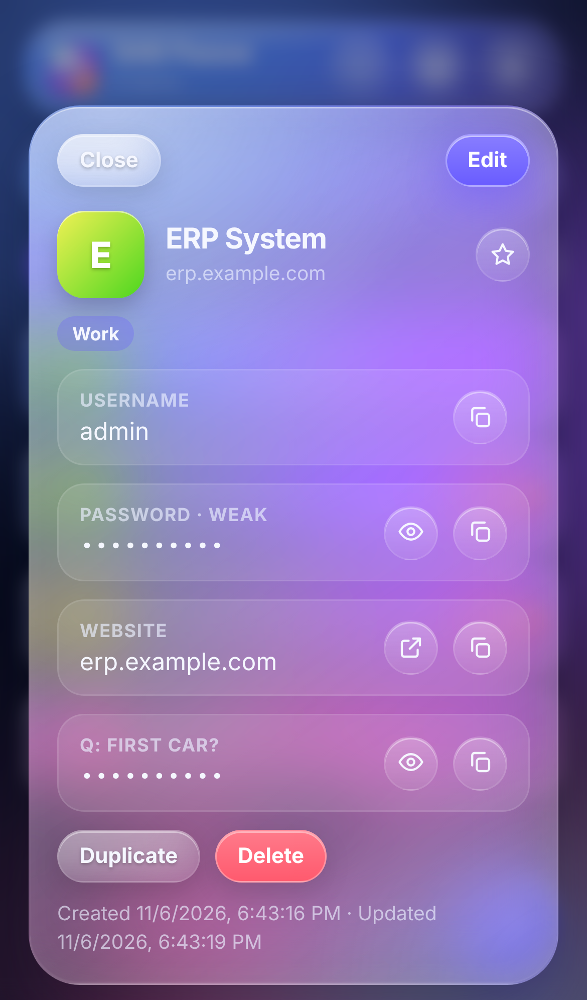
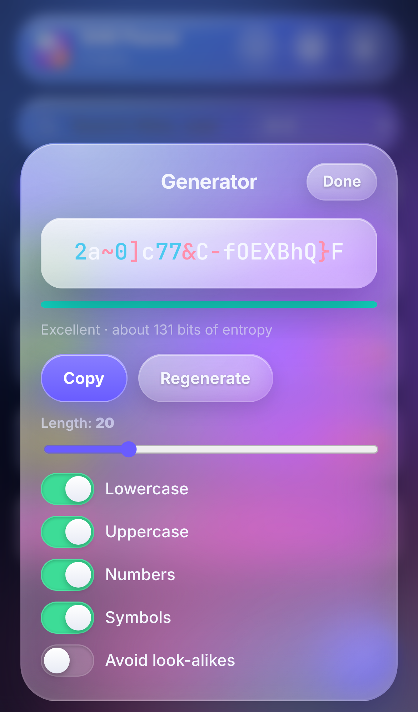
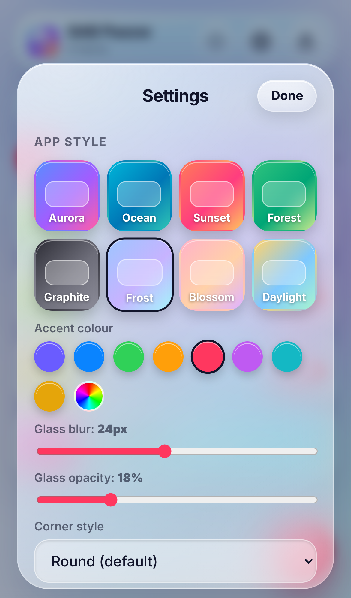

# SAB Passw

A private, offline password vault with a liquid-glass interface, switchable app styles, and full export/import.

It is a Progressive Web App: open it once in Safari (iPhone/iPad) or Chrome (Android/desktop), then
**Share → Add to Home Screen** (iOS) or **Install app** (Chrome). It then launches full-screen with its own icon and works offline.

| Vault | Record | Generator | Styles |
|---|---|---|---|
|  |  |  |  |

## Features

- **Records:** title, username, password, website, notes, tags, favourites, custom fields (plain or hidden), security questions, and automatic password history.
- **Password generator:** 6–64 characters; lowercase, uppercase, numbers and symbols; option to avoid look-alike characters. Uses the browser's cryptographic random generator.
- **Strength meter**, plus **Weak** and **Reused** filters to find passwords that need changing.
- **Search, tags, sorting** (A–Z, recent, weakest first).
- **App style:** 8 themes (Aurora, Ocean, Sunset, Forest, Graphite, Frost, Blossom, Daylight), accent colour (presets or any custom colour), glass blur, glass opacity, corner roundness, animated background on/off.
- **Export:**
  - *Encrypted backup* (`.sabpw`): every record, protected by a backup password you choose.
  - *CSV*: plain text, for moving to another password manager. It asks for your master password first.
- **Import:**
  - SAB Passw `.sabpw` backups.
  - CSV exports from most password managers and browsers. Common column names such as `name/title`, `url/login_uri`, `username/login_username`, `password`, `notes/extra` and `folder/grouping` are detected automatically.
  - *Merge* (skips exact duplicates) or *Replace all*.
  - A backup can be restored on first launch, before a vault exists.
- **Security:** auto-lock after inactivity (1–30 minutes), locking when the app is minimised, clipboard clearing after copying a password, and an increasing delay after repeated wrong passwords.

## Security design

- The vault is a single JSON document encrypted with **AES-256-GCM**.
- The key is derived from your master password with **PBKDF2-SHA256, 600,000 iterations, random 16-byte salt**.
- Only the ciphertext, salt and IV are stored (browser `localStorage`, on this device only).
- Decrypted data and the key exist only in memory while unlocked.
- Backups use the same scheme, with their own salt and password.
- Nothing is sent over the network.
- A strict Content-Security-Policy blocks all external scripts and connections.
- **There is no password recovery.** If you forget the master password, the data cannot be decrypted. Export an encrypted backup regularly.
- Clearing the browser's site data deletes the vault. Keep a backup.

## Run / host

Plain static files: no build step and no dependencies.

```bash
cd sab-passw
python3 -m http.server 8080   # then open http://localhost:8080
```

To use it on a phone, host the folder on any HTTPS static host (GitHub Pages, Netlify, an internal web server) and open the URL.
HTTPS (or `localhost`) is required, because browsers only allow the Web Crypto API in secure contexts.

## Files

| File | Purpose |
|---|---|
| `index.html` | Layout: lock screen, vault, sheets |
| `styles.css` | Liquid-glass design system and themes |
| `app.js` | Encryption, records, generator, import/export, auto-lock |
| `sw.js` | Offline cache |
| `manifest.webmanifest`, `icons/` | Install metadata and app icons |
